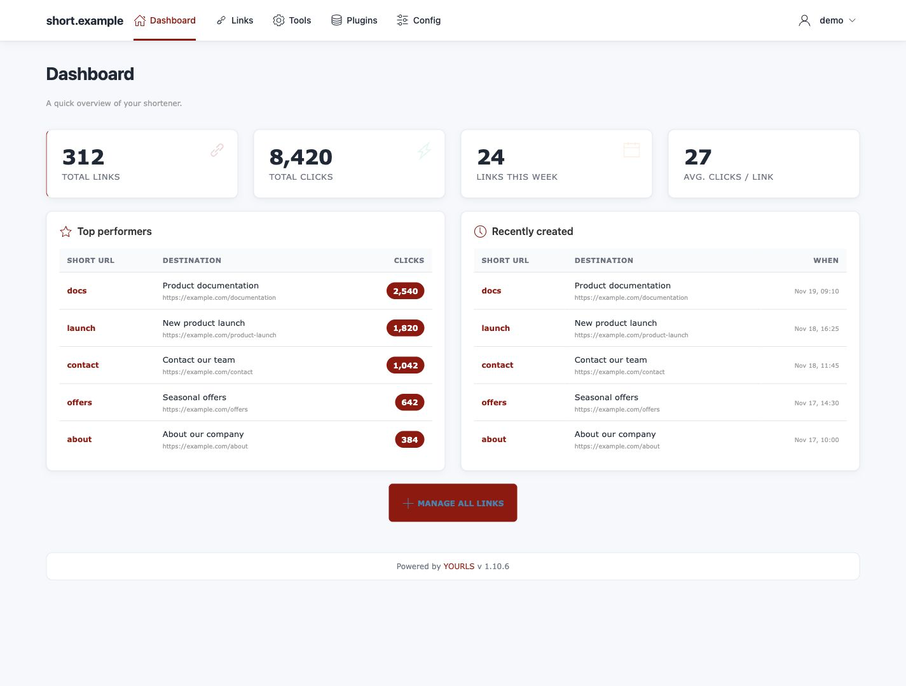
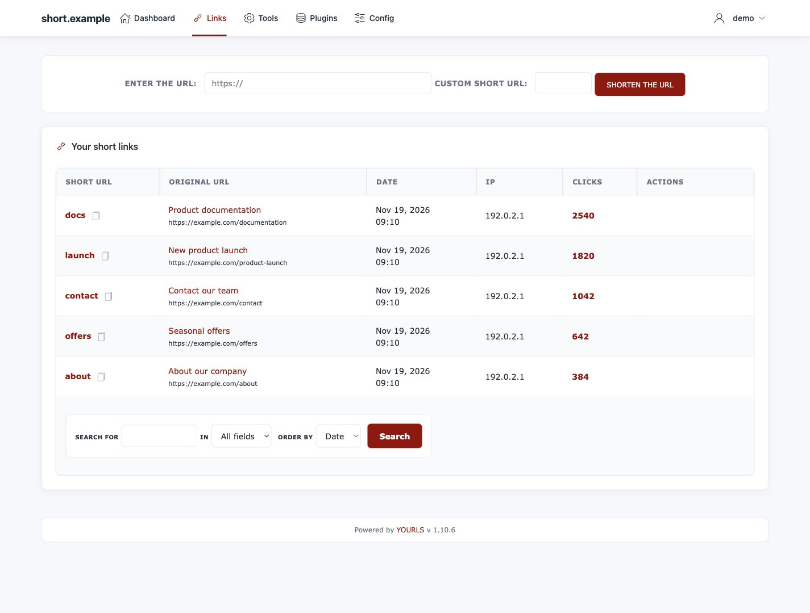
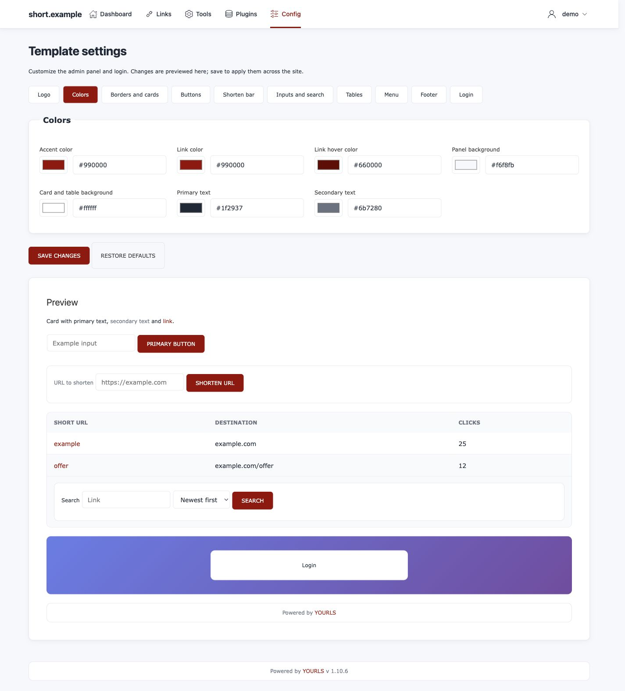
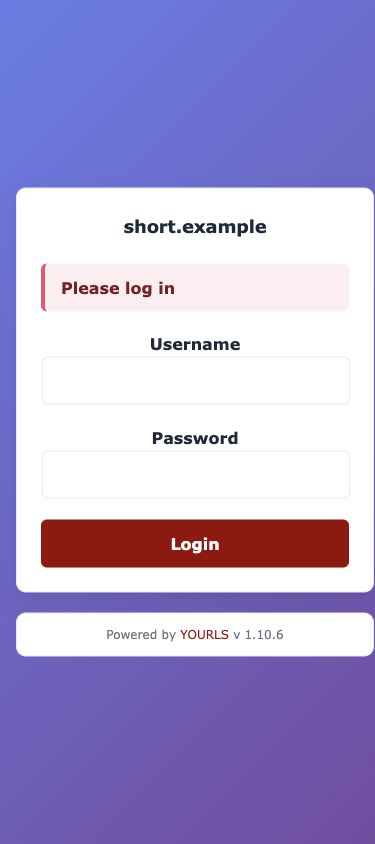
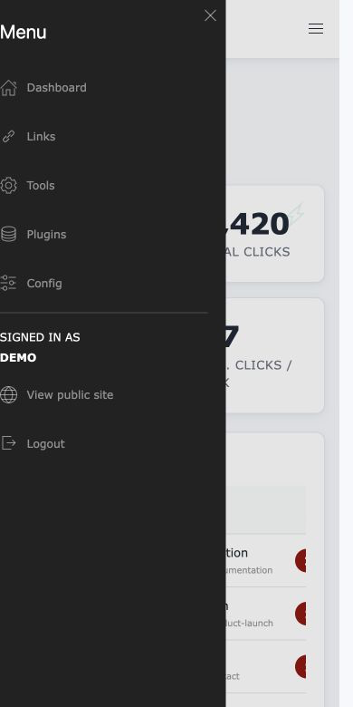

# YOURLS UIkit Template

[](https://github.com/YOURLS/awesome-yourls/)

A customizable admin template for [YOURLS](https://yourls.org/), built on UIkit 3. It styles the existing admin interface and adds a dashboard and theme configurator without modifying YOURLS core files.

Current template version: **1.6.6**.

## Screenshots

These screenshots show the current template with demonstration data and a red accent. Domains, usernames, IP addresses and counts are examples, not production data. Dashboard and Config use the plugin's page renderers; the Links and login previews use representative YOURLS markup.

### Dashboard



### Links



### Config



### Mobile login and navigation

 

## Features

- **Consistent page frame:** shared 1280 px maximum width, aligned header and footer, and responsive side margins across Links, Dashboard, Tools, Plugins, Config and statistics.
- **Stable sticky header:** layout is reserved before UIkit JavaScript initializes, preventing the menu from expanding during page load.
- **Account dropdown:** View public site and Logout, with YOURLS's native nonce-protected logout URL.
- **Mobile navigation:** the header contains only the site name/logo and hamburger. The dark offcanvas menu includes navigation, the signed-in user, public site and logout.
- **Dashboard:** total links, clicks, links created this week, average clicks per link, top performers and recent links. Cards adapt to smaller screens.
- **Links:** themed shortening form, table, search controls and copy-to-clipboard actions. Original row action icons are recolored rather than turned into filled buttons; desktop hover/focus behavior is preserved.
- **Tools:** grouped sections, themed bookmarklet links, readable API examples and a horizontally scrollable table on small screens.
- **Plugins:** themed table and filter icon, with activation/deactivation kept as links that appear on row hover or keyboard focus on desktop.
- **Statistics:** centered layout, responsive columns, themed tabs and historical click lists. Google line charts, pie charts and maps use the configured accent/palette. Visible charts redraw when the period, tab or viewport changes.
- **Responsive login:** customizable gradient, card width, logo, readable mobile inputs and touch-friendly controls.
- **Custom logo and favicon:** upload, replace or remove both from the Logo tab.
- **Tabbed Config:** 40 appearance settings, live preview, shared Save changes and Restore defaults. Preview stays visible below the tabs; unsaved values survive tab switches. The selected tab is remembered within the browser session.
- **Portable plugin folder:** CSS, JavaScript and icon URLs follow the actual plugin directory and configured YOURLS plugin URL.

## Requirements

- PHP 8.x and a compatible YOURLS installation. Development checks were performed with YOURLS 1.10.6; other versions are not verified here.
- PHP **GD** for logo/favicon image decoding and PNG output. WebP upload support also depends on the server's GD build.
- The web server must be able to create/write `YOURLS_USERDIR/ui-kit-uploads`, or that directory must be created with appropriate permissions before uploading.
- A modern browser supporting CSS Grid, custom properties and CSS masks.
- Access to jsDelivr for UIkit **3.25.16**, unless you self-host its assets. Statistics also use the Google Charts resources loaded by YOURLS.

## Installation and updates

1. Copy the plugin directory into your YOURLS `user/plugins/` directory. The directory name is flexible; for example:

   ```text
   user/plugins/uikit-template/
   ├── plugin.php
   ├── README.md
   ├── assets/
   │   ├── skin.css
   │   ├── skin.js
   │   └── icons/
   └── images/screenshots/
   ```

2. Open **Plugins** in the existing YOURLS admin and activate **YOURLS UI Kit Template**.
3. Use **Config** in the top navigation or mobile menu to customize the template.
4. On updates, replace the plugin files, including `assets/icons/`, and refresh the browser cache if necessary. Keep `YOURLS_USERDIR/ui-kit-uploads` when updating.

### Renaming the plugin folder

Deactivate the plugin, rename its directory, and reactivate it from Plugins. YOURLS records active plugins by their folder path, so renaming an active directory requires reactivation.

Asset URLs are resolved with `yourls_plugin_url(__DIR__)`. Theme settings and uploaded branding are independent of the plugin directory name and are preserved.

## Configuration

Open **Config**. Each category has its own tab, while the preview remains visible underneath. Editing a field changes the local preview immediately; **Save changes** applies all appearance fields across the site. Switching tabs does not discard unsaved values. Invalid fields are revealed in their tab before browser validation focuses them.

| Tab | Options |
| --- | --- |
| Logo | Upload/remove the site logo and favicon; each has its own upload form. |
| Colors | Accent, link and hover colors, panel/card backgrounds, primary and secondary text. |
| Borders and cards | Border color/width and card/input corner radii. |
| Buttons | Corner radius, horizontal/vertical padding and primary button text color. |
| Shorten bar | Background, text color and padding. |
| Inputs and search | Input/select colors and padding; search panel colors. |
| Tables | Header, row, alternating row, hover and footer backgrounds; cell padding and font size. |
| Menu | Navbar background and text color. |
| Footer | Footer background, text color and padding; borders and links follow the shared settings. |
| Login | Gradient colors/angle and desktop card width. On phones the login uses the available width. |

**Restore defaults** resets appearance fields. It does not remove the uploaded logo or favicon; use their individual Remove controls instead.

### Logo and favicon uploads

- Accepted source formats: **PNG, JPEG and WebP**.
- Maximum upload size: **2 MB**.
- Maximum dimensions: **4096 pixels per side**, with a **4 megapixel** total limit.
- The favicon must be square. A **32 × 32** or **64 × 64** transparent PNG is recommended.
- Images are decoded and re-encoded as PNG, with generated filenames. The original filename is not used for storage.
- The logo replaces the site name in the navbar and login. The favicon uses YOURLS's `get_favicon_url` filter for pages that use its standard favicon helper.
- Reload after uploading to update the header/browser icon. Browsers may retain an old favicon in their cache.
- Uploads live in `YOURLS_USERDIR/ui-kit-uploads`, outside the plugin folder. Replacing/removing an image deletes the corresponding managed file after its option is updated. A failed option save removes the newly written image.
- Upload and remove actions use YOURLS nonces. Give the web-server user write access only to the uploads directory; world-writable permissions are not required.

Short URLs redirecting to another website ultimately show that destination site's favicon.

### Stored settings

The template uses the existing YOURLS options table:

| Option | Purpose |
| --- | --- |
| `sb_uikit_theme` | Appearance settings. |
| `sb_uikit_logo` | Generated logo filename. |
| `sb_uikit_favicon` | Generated favicon filename. |
| `sb_uikit_accent` | Legacy accent fallback when no newer accent setting is saved. |

No additional database tables or SQL migration are needed. Colors and numeric ranges are validated on the server; arbitrary CSS is not accepted through the configurator.

## Developer customization

- `plugin.php`: hooks, navbar, dashboard, configuration schema, uploads and chart option filters.
- `assets/skin.css`: theme variables, page layout and responsive styles.
- `assets/skin.js`: live preview, tabs, page grouping, copy actions and chart redraws.
- `assets/icons/`: monochrome SVG masks for original action/filter icons.

Appearance fields are defined in `yourls_ui_kit_template_fields()`. This schema drives field rendering, validation and CSS variable output. The dashboard renderer is `yourls_ui_kit_template_dashboard_page()`.

The template uses YOURLS hooks including `html_head`, `html_logo`, `plugins_loaded`, `admin_page_before_table`, `admin_page_after_table`, `get_favicon_url` and the `stats_*_options` filters. Authentication, link operations and plugin management remain in YOURLS.

## Self-hosting UIkit

1. Download the matching UIkit distribution from the official UIkit website.
2. Place `uikit.min.css`, `uikit.min.js` and `uikit-icons.min.js` under `assets/uikit/`.
3. In `yourls_ui_kit_template_head()`, replace the three jsDelivr URLs with escaped URLs based on `$plugin_url`, for example:

   ```php
   <link rel="stylesheet" href="<?php echo yourls_esc_attr($plugin_url); ?>/assets/uikit/uikit.min.css" />
   <script src="<?php echo yourls_esc_attr($plugin_url); ?>/assets/uikit/uikit.min.js" defer></script>
   <script src="<?php echo yourls_esc_attr($plugin_url); ?>/assets/uikit/uikit-icons.min.js" defer></script>
   ```

Self-hosting UIkit does not make YOURLS's Google Charts statistics available offline.

## Limitations and verification

- Third-party plugin pages can inherit base styles, but custom markup may need additional styling. Avoid running multiple admin skins together: their CSS can conflict.
- Original YOURLS branding markup is hidden consistently by CSS; core files are not replaced.
- Config tabs, grouping, dropdown/offcanvas navigation and live preview require JavaScript. Without enhancement, the settings content remains available as a longer page.
- The dashboard runs direct aggregate/list queries; it does not cache large datasets.
- Validation included PHP lint, browser checks at desktop/mobile widths, header alignment and pre/post-JavaScript sizing, tab/preview/filter checks, and isolated HTTP upload/removal tests. Screenshot examples are demonstration renders and are not evidence of a production deployment or a live authenticated end-to-end test.

## Uninstall

Use **Remove logo** and **Remove favicon** first if you want to remove uploaded branding. Then deactivate the plugin in Plugins and delete its plugin directory.

Deactivation preserves saved settings and images. A full manual cleanup also removes `sb_uikit_theme`, `sb_uikit_logo`, `sb_uikit_favicon` and the legacy `sb_uikit_accent` option, plus remaining template-managed images in `YOURLS_USERDIR/ui-kit-uploads`. Do not delete unrelated YOURLS options or uploaded files.

## Licence

MIT. Original author and credit links are retained below.

## Say thanks for this free template

Say thanks by following our social medias and shooting us a message.

- [Facebook - Square Balloon](https://www.facebook.com/squareballoon.co.uk/)
- [LinkedIn - Square Balloon](https://www.linkedin.com/company/2732306/admin/dashboard/)
- [Instagram - Square Balloon](https://www.instagram.com/squareballoon)
- [X / Twitter - Square Balloon](https://x.com/SquareBalloonUk)
- [YouTube - Square Balloon](https://www.youtube.com/c/SquareballoonCoUk)

### Feeling even more grateful?

Say thanks by following my comedy business accounts too:

- [Facebook - London Comedy](https://www.facebook.com/londoncomedycrew/)
- [Instagram - London Comedy](https://www.instagram.com/londoncomedycrew)
- [TikTok - London Comedy](https://www.tiktok.com/@londoncomedycrew)
- [Bluesky - London Comedy](https://bsky.app/profile/londoncomedy.bsky.social)
- [YouTube - London Comedy](https://www.youtube.com/@LondonComedyUk)

#### And my personal ones:

- [Instagram - Eoin Oh Comedy](https://www.instagram.com/eoinohcomedy/)
- [Facebook - Eoin Oh Comedy](https://www.facebook.com/profile.php?id=61579112321959)

**Thanks! Love you guys.** ❤️
